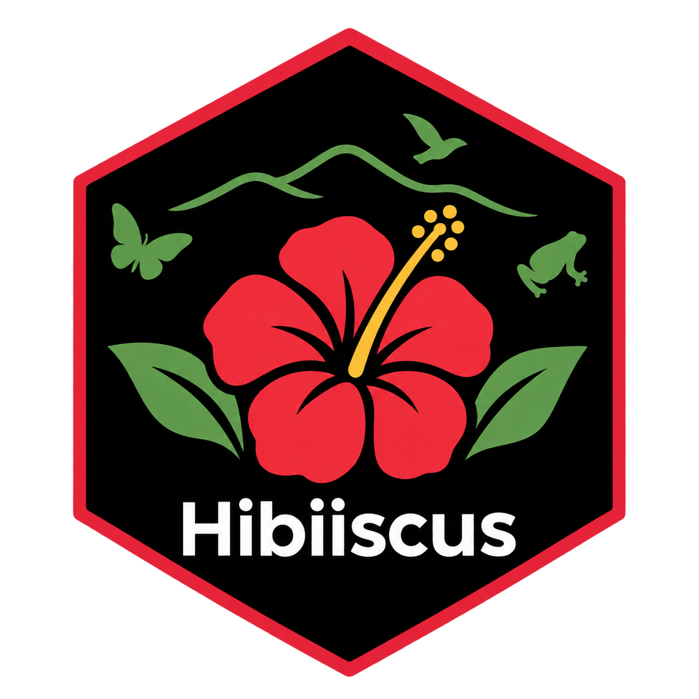

<!-- README.md is generated from README.Rmd. Please edit that file -->

# hibiiscus - Modelling framework for hierachical ecological impact analysis



<!-- badges: start -->

[](https://CRAN.R-project.org/package=hibiiscus)
[](https://creativecommons.org/licenses/by/4.0/)
[](https://lifecycle.r-lib.org/articles/stages.html#experimental)
[](https://iiasa.r-universe.dev/hibiiscus)
[](https://app.codecov.io/gh/iiasa/hibiiscus)
[](https://github.com/iiasa/hibiiscus/actions/workflows/R-CMD-check.yaml)
[](https://doi.org/10.1111/ddi.70255)
<!-- badges: end -->

<!--<Text to be written!> -->

## Installation

The latest version can be installed from GitHub or R-Universe. A CRAN
release will eventually be planned.

``` r
install.packages("devtools")
devtools::install_github("IIASA/hibiiscus")

# Or from R-universe
install.packages("hibiiscus", repos = "https://iiasa.r-universe.dev")
```

## Overview

**hibiiscus** is an `R` package for conducting ecological impact
analyses with hierarchical data. It allows for reproducible workflows
spanning data preparation, through model fitting, impact estimation to
model projection on new covariates. It incorporates functionality for
estimating a range of ecological/biodiversity indicators (taxonomic
diversity), fitting frequentist and Bayesian models, and model
evaluation (including cross-validation, and area-of-applicability, Meyer
and Pebesma, 2021).

**hibiiscus** is based on R6 Classes (objects) with data components
internally stored as `data.frame`/`tibble` or **terra** `SpatRaster`.

## Using hibiiscus

This package is designed to help with processing and modelling
PREDICTS-like data. All standalone functions have the prefix `hib_`, and
modify the focal R6 object. A brief example of how to load and process
the data is shown below. Further examples can be found in the vignettes.
Please check the reference section for full details of functionality.

``` r
library(hibiiscus)

# Load the 2016 PREDICTS data
hib_db <- hib_load_db("../data/predicts/2016_v1.1/database.rds",
                      "../data/predicts/2016_v1.1/sites.rds",
                      "PREDICTS_2016")

# Filter data to 'Europe'
hib_db <- hib_filter_sites(hib_db, 
                           UN_region == "Europe")

# Run linear effort correction
hib_db$hib_effort_correction()

# Calculate total abundance for each site
hib_db <- hib_calc_div_within(hib_db,
                              c("Total_abundance"))
```

## Citation

if you use the software, please cite the following reference:

> Cornford, R & Jung, Martin (2026). hibiiscus - Modelling framework for
> hierachical ecological impact analysis. R package version 0.1,
> <https://github.com/iiasa/hibiiscus>.

Please also cite the publication for which this software was developed:

> Cornford, R., M. Jung, and P. Visconti. 2026. “ Stress-Testing
> Model-Derived Biodiversity Indicators Under Different Assumptions of
> Land-Use Change Impacts.” Diversity and Distributions 32, no. 11:
> e70255. <https://doi.org/10.1111/ddi.70255>

## Acknowledgement

The **hibiiscus** framework is developed by the Biodiversity, Ecology
and Conservation group at the International Institute for Applied
Systems Analysis (IIASA), Austria.

The developers are grateful to the [PREDICTS
initiative](https://www.nhm.ac.uk/our-science/our-work/biodiversity/predicts.html)
and all data contributors for making available primary ecological data
for broad scale analyses.

This project has received funding from the European Union’s Horizon
Europe Research and Innovation programme under Grant Agreement No
101060423 (LAMASUS).

## Contributors

<!-- ALL-CONTRIBUTORS-LIST:START - Do not remove or modify this section -->

<!-- prettier-ignore-start -->

<!-- markdownlint-disable -->

<table>

<tr>

<td align="center">

<a href="https://github.com/rcornf">

</a><br>
<a href="https://github.com/iiasa/hibiiscus/commits?author=rcornf">rcornf</a>
</td>

<td align="center">

<a href="https://github.com/Martin-Jung">

</a><br>
<a href="https://github.com/iiasa/hibiiscus/commits?author=Martin-Jung">Martin-Jung</a>
</td>

</tr>

</table>

<!-- markdownlint-enable -->

<!-- prettier-ignore-end -->

<!-- ALL-CONTRIBUTORS-LIST:END -->

<!-- get_contributors(org = "IIASA", repo = "hibiiscus") -->
